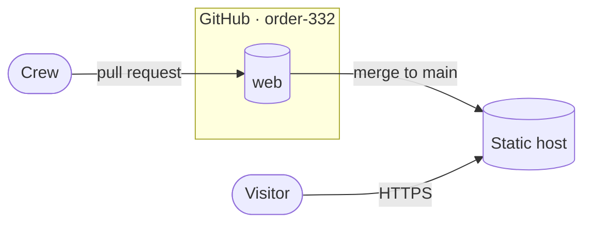
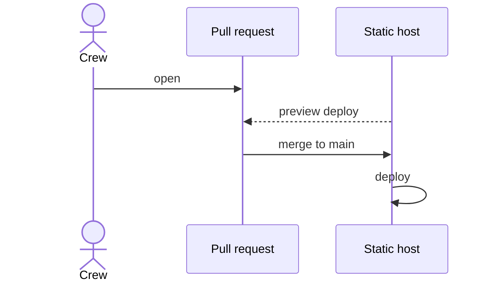

# Architecture

One static page. Plain HTML and CSS, no framework, no build step, no third-party requests. The host serves the files as they are in the repo.

## System

## Files

| File | What |
|---|---|
| `index.html` | The page |
| `style.css` | All styling |
| `_headers` | Security headers and CSP, applied by the host |

JavaScript only if the page needs it, as a file of our own (`main.js`). Fonts and images are self-hosted.

## Security

Security comes from the host's response headers and from having almost nothing to attack:

- Strict CSP: `default-src 'none'`, then only our own files. No inline scripts or styles.
- HSTS with preload, `nosniff`, `no-referrer`, a Permissions-Policy that turns everything off, and COOP/CORP `same-origin`.
- No dependencies, no analytics, no CDNs, no embeds.
- 2FA on the registrar, host and GitHub; DNSSEC and a CAA record on the domain.

Check with Mozilla HTTP Observatory and securityheaders.com after each deploy.

## Release

## Open decisions

- **CTF:** a CTF platform we host (challenges, scoreboard, accounts) goes on its own subdomain as a separate app, never inside this site. Results or writeups would be content here instead; writeups are the point where a static site generator (Astro) becomes worth it.
- **Host:** Cloudflare Pages or Netlify.
- **Domain:** to be decided.
