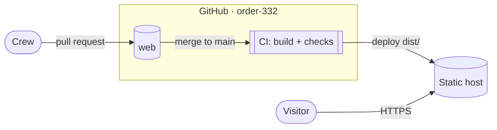
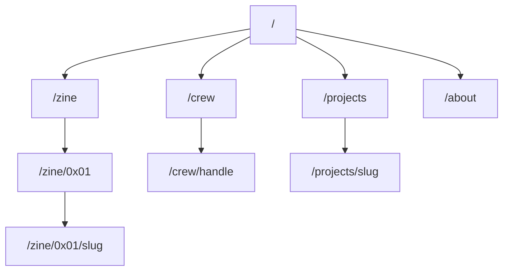
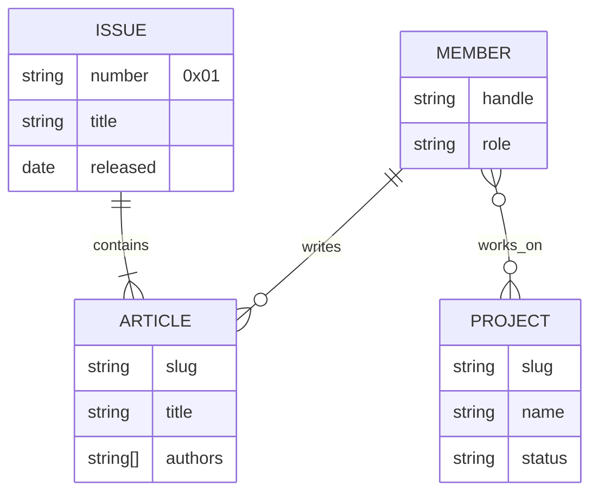
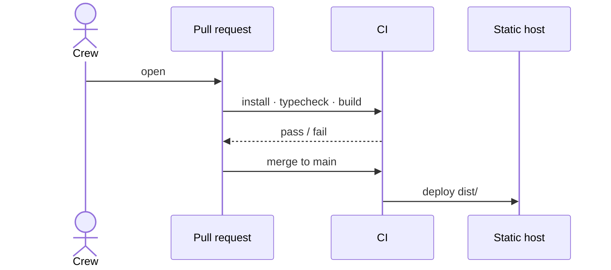

# Architecture

Static site. Built ahead of time, served as plain files.

## System

## Pages

## Content

## Release

## Open decisions

- **Framework:** Astro on Bun, or Bun's HTML bundler.
- **Host:** Cloudflare Pages or Netlify.
- **Domain:** to be decided.
