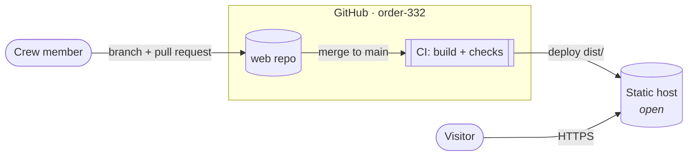
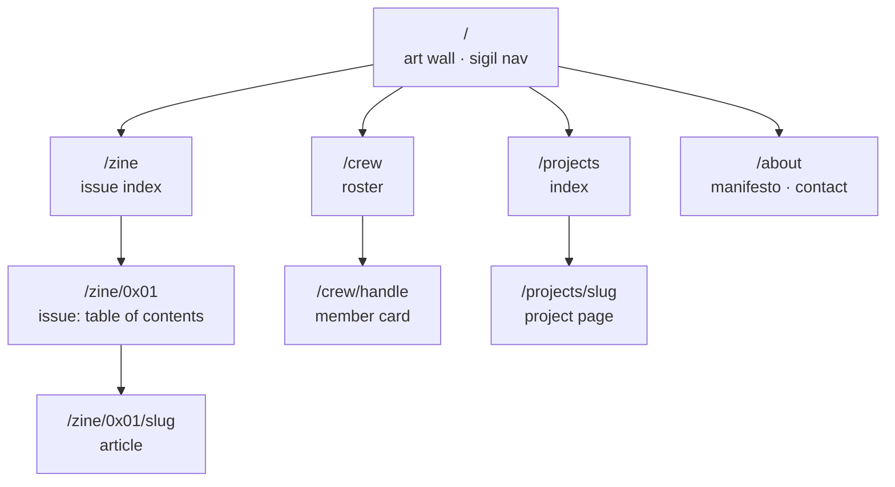
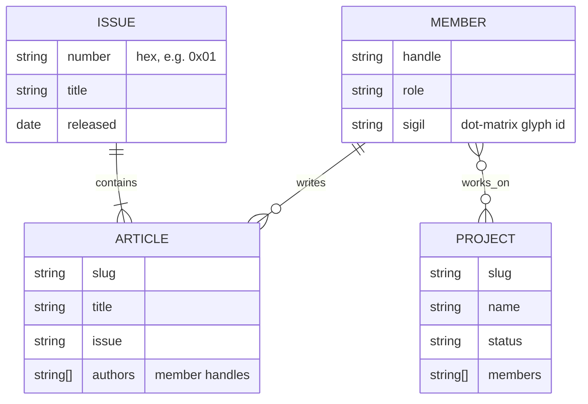
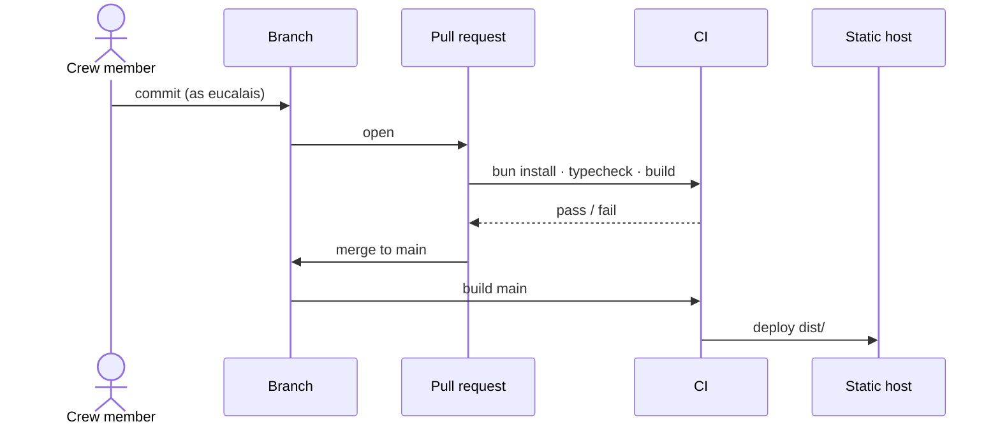

# Architecture

> Status: **draft.** This describes the intended shape of the site. Anything marked *proposed* or *open* is not decided yet. Decisions that settle it get an [ADR](adr/0000-template.md).

## What the site is

332 is four things at once, and the site gives each one a home:

| Facet | What it needs | Section |
|---|---|---|
| Crew | Who's in it, what they do | `/crew` |
| Handle | The identity itself: sigil, manifesto, contact | `/` and `/about` |
| Zine | Issues made of articles, Phrack-style | `/zine` |
| Project | Things 332 builds and releases | `/projects` |

The site is static: pages are built ahead of time and served as plain files. Nothing in it needs a server or database at runtime.

## Context

Who touches the site, and what it sits on.



## Site map (proposed)



Issue numbers are hex (`0x01`, `0x02`, …), in the spirit of the references.

## Content model (proposed)

Content lives in the repo as text files (Markdown with front matter), so writing an article is editing a file and opening a pull request.



## Build and release



## Repository layout

```
web/
├─ docs/
│  ├─ architecture.md   this file
│  ├─ adr/              decision records
│  └─ research/         local notes, not committed
└─ README.md
```

Source folders (`src/`, `content/`, `public/`) arrive with the first code, once the framework is chosen.

## Open decisions

These are the critical ones. Each gets an ADR when it's settled.

1. **Framework.** Bun is the runtime and package manager either way. The question is what renders the pages:
   - *Astro on Bun*: built for content sites. Markdown articles, typed content collections, and zero JavaScript by default with interactive islands where needed (glyph nav, CRT effects).
   - *Bun's built-in HTML bundler*: no framework, fewest dependencies, but articles, layouts and the content model would be hand-built.
2. **Hosting.** The repo is private, which rules out GitHub Pages on the free plan. That leaves Cloudflare Pages or Netlify, both of which deploy from a private repo.
3. **Domain.** Custom domain, or the host's default.
